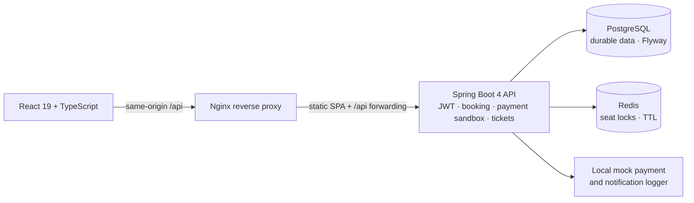

# EventHub

Full-stack event discovery and ticketing application. The REST API is built with Spring Boot 4 and Java 21; the responsive web client uses React 19 and TypeScript.

The frontend source and setup instructions live in [`frontend/`](frontend/README.md).

## Portfolio overview

EventHub is a full-stack event discovery and ticketing project built around one hard problem: making seat reservations and ticket admission safe across concurrent requests. It includes a mock payment sandbox and local notification logging; it does not process real payments or send messages.

### Highlights

- Responsive event discovery with filters, sorting, pagination, seat availability, and pricing.
- JWT login, protected frontend routes, and server-enforced CUSTOMER, ORGANIZER, and ADMIN permissions.
- Redis-backed, expiring seat locks; idempotent booking/payment operations; PostgreSQL constraints for durable seat claims.
- QR-safe ticket references with atomic one-time organizer admission checks.
- Customer booking history, wishlist, post-event verified reviews, and ticket wallet.
- Organizer-owned event management and database-backed statistics; admin account/inventory/event moderation and platform statistics.
- Flyway schema migrations, Swagger/OpenAPI, consistent API errors, Docker Compose, and a disposable stack verifier.
- Mock payment completion is available only under the explicit `demo` profile; production mode has no configured payment provider and rejects payment initiation.

### Architecture



PostgreSQL is the source of truth for accounts, events, bookings, payment attempts, and tickets. Redis stores temporary event-seat locks; a unique PostgreSQL claim constraint is the final protection against double booking. Nginx serves the production frontend bundle and strips the `/api` prefix before proxying API calls.

### Role matrix

| Capability | Guest | CUSTOMER | ORGANIZER | ADMIN |
|---|---:|---:|---:|---:|
| Browse events and public reviews | Yes | Yes | Yes | Yes |
| Reserve seats, pay in mock sandbox, view own tickets | — | Yes | — | — |
| Wishlist and eligible post-event reviews | — | Yes | — | — |
| Manage own events and view own event statistics | — | — | Yes | — |
| Verify tickets for owned events | — | — | Yes | Yes |
| Manage accounts, venue inventory, and event moderation | — | — | — | Yes |
| View platform statistics | — | — | — | Yes |

Role checks and ownership checks are enforced by the backend; frontend route guards only improve navigation and user experience.

### Demo flow

1. Start the Compose stack and set `SEED_DEMO_CATALOG=true` if you want the built-in fictional catalog loaded at backend startup.
2. Register a customer account, browse an event, choose available seats, and follow the reservation countdown.
3. In the local `demo` profile, complete the mock checkout with a simulated outcome; the confirmation page refreshes backend state before showing tickets and QR codes.
4. Visit the customer dashboard to inspect booking history, payment status, tickets, and saved events. Reviews unlock only after a confirmed booking and event completion.
5. After registering the account you intend to use, set `ADMIN_BOOTSTRAP_EMAIL` to that exact email and restart the backend once to grant that existing active account the ADMIN role. Remove the variable after promotion. No privileged account or password is created by the application.

### Screenshot placeholders

Add captured UI images under `docs/screenshots/` when a local stack is available. Suggested captures:

| File placeholder | Screen |
|---|---|
| `docs/screenshots/event-discovery.png` | Home and filtered event browsing |
| `docs/screenshots/seat-selection.png` | Seat states and reservation countdown |
| `docs/screenshots/customer-wallet.png` | Booking history and QR tickets |
| `docs/screenshots/organizer-dashboard.png` | Owned events and statistics |
| `docs/screenshots/admin-dashboard.png` | Platform statistics and moderation |

These are capture placeholders, not checked-in screenshots.

### Latest verification (2026-11-06)

| Check | Result |
|---|---:|
| `mvn clean test -q` | 43 tests passed; 0 failures, errors, or skips |
| `mvn -q -DskipTests package` | Passed |
| `npm test -- --run` | 16 tests passed |
| `npm run build` | Passed |
| `node --check scripts/verify-compose.mjs` | Passed |

The current backend suite includes repeat-run catalog seeding and exact-email administrator-bootstrap coverage. The catalog creates no users or booking/payment data; both production startup mechanisms remain disabled unless their explicit environment variables are set.

The H2 suite and in-memory reservation-store tests are not evidence of live infrastructure verification. The local Compose stack was verified on 2026-11-05; see the Docker guide below. The full transaction/concurrency verifier is still pending.

### Docker verification status

**Verified locally on 2026-11-05.** PostgreSQL, Redis, backend, and frontend reached healthy status; Flyway V1–V7 succeeded; frontend and proxied health/event endpoints responded. The complete reservation, payment, ticket scan, and concurrency script has not yet run. See “Docker verified” below for commands and scope.

The production-profile, profile-gated payment, and CORS changes documented below were validated by tests/builds and `docker compose config --quiet`; containers were not rebuilt or restarted for these changes.

## Setup

1. Create a PostgreSQL database (default local name: `eventhub`).
2. Set `DB_URL`, `DB_USERNAME`, and `DB_PASSWORD`.
3. Set `JWT_SECRET` to a random secret with at least 32 UTF-8 bytes. `JWT_EXPIRATION_MS` defaults to 86,400,000 ms.
4. Start Redis locally (for example, `docker run --name eventhub-redis -p 6379:6379 -d redis:7-alpine`).
5. Run `mvn spring-boot:run -Dspring-boot.run.profiles=demo` for the complete local mock-payment demo.

Flyway applies schema migrations. Existing installations are baselined at version 1 and upgraded with additive legacy migrations; new databases apply the complete schema and constraints. Hibernate defaults to `validate`; avoid schema auto-update in production. Tests use in-memory H2 and a deterministic reservation-store test double, so they need no PostgreSQL, Redis, Docker, or secrets.

Required environment variables are `DB_URL`, `DB_USERNAME`, `DB_PASSWORD`, and `JWT_SECRET` (at least 32 UTF-8 bytes). Redis defaults to `localhost:6379`; set `REDIS_HOST`, `REDIS_PORT`, and, when Redis authentication is enabled, `REDIS_USERNAME` and `REDIS_PASSWORD`. `SEAT_RESERVATION_TTL` defaults to `PT5M` and accepts values from 30 seconds through 15 minutes. `JWT_EXPIRATION_MS` defaults to one day.

PowerShell local setup example (replace placeholders with your own database settings and secret):

```powershell
$env:DB_URL = 'jdbc:postgresql://localhost:5432/eventhub'
$env:DB_USERNAME = '<database-user>'
$env:DB_PASSWORD = '<database-password>'
$env:JWT_SECRET = '<random-secret-of-at-least-32-UTF-8-bytes>'
$env:REDIS_HOST = 'localhost'
$env:REDIS_PORT = '6379'
mvn spring-boot:run -Dspring-boot.run.profiles=demo
```

An explicit `demo`, `dev`, or `development` profile is required for the local mock payment sandbox; production mode always takes precedence and disables it. Without one of these development profiles, the simulation endpoint is not registered and payment initiation is disabled until a real provider is configured. Compose activates `demo` for its local stack.

## Docker local demo (D1–D2)

The Compose stack runs the React production build behind Nginx, the Spring Boot API, PostgreSQL, and Redis. PostgreSQL and Redis use named local volumes. PostgreSQL and Redis are exposed only on `127.0.0.1`; the backend is reachable through Nginx at `/api`. The included environment values are for a local-only demo and are not deployment secrets.

Requirements: Docker Desktop (or Docker Engine) with the Compose plugin. From the repository root in PowerShell:

```powershell
Copy-Item .env.example .env
# Generate an ephemeral 48-byte key for this PowerShell session. To persist a
# local-only key, write the generated value into JWT_SECRET in .env instead.
$bytes = New-Object byte[] 48
$rng = [System.Security.Cryptography.RandomNumberGenerator]::Create()
$rng.GetBytes($bytes)
$env:JWT_SECRET = [Convert]::ToBase64String($bytes)
docker compose config --quiet
docker compose up --build -d
docker compose ps
docker compose logs -f backend
```

Open the frontend at `http://localhost:8088` (or the `HTTP_PORT` set in `.env`). The Nginx `/api/` route removes the prefix before forwarding to Spring, so the browser uses the same-origin API proxy. API docs are available at `http://localhost:8088/api/swagger-ui.html`; `/healthz` checks Nginx, and the backend readiness health check includes PostgreSQL and Redis. The first start applies Flyway migrations to the empty PostgreSQL volume. Register customer accounts in the UI. To explore the built-in fictional catalog, set `SEED_DEMO_CATALOG=true` in local `.env` before starting or restarting the backend. To explore admin-only screens, register the intended account first, set `ADMIN_BOOTSTRAP_EMAIL` to that email, and restart the backend; the bootstrap never creates an account or changes a password.

### Opt-in application seed and administrator bootstrap

`SEED_DEMO_CATALOG` defaults to `false`. When explicitly set to `true`, the startup seeder adds exactly four future-dated, richly described events for each of Concert, Theatre, Movie, Sports, Standup, and Workshop (24 total), with stable Unsplash image URLs. It also ensures six demo venues and screens, 64 seats per screen, and four demo seat categories with server-side prices. Re-running it reuses existing named records and skips existing event names/types; it creates no accounts, bookings, tickets, or payments and does not modify existing category prices.

`ADMIN_BOOTSTRAP_EMAIL` is a separate opt-in startup mechanism. It promotes only the already registered account matching that email (case-insensitively) to `ADMIN`. It never creates a user, changes a password, or changes any other account. If the account is not registered yet, startup makes no change; set the variable after registration and restart the backend. Remove it after a successful promotion so it cannot re-promote the account if its role is later changed. Protect this variable like an administrator credential.

To add fictional events and seats for local browsing, manually load the optional catalog seed after the backend has completed Flyway migrations. The script requires an explicit switch and a typed confirmation, and only operates on the running local Compose `postgres` service:

```powershell
.\scripts\seed-demo.ps1 -ConfirmDemoSeed
```

This separate PowerShell seed script is manual and only targets the local Compose database. It contains no users, password hashes, admin account, bookings, or payment data. The guarded script reads the local Compose database/user settings from `.env`.

For the organizer ticket-scan check, register `organizer@example.test` through the local UI first, then promote that local account and attach it to the seeded event. These SQL commands are for the localhost-bound disposable Compose database only; they deliberately do not create an admin account:

```powershell
docker compose exec -T postgres psql -v ON_ERROR_STOP=1 -U eventhub -d eventhub -c "UPDATE users SET role='ORGANIZER' WHERE email='organizer@example.test' AND role='CUSTOMER' AND is_active=true;"
$env:EVENT_ID = '123' # Replace with a seeded event id from the seed output.
docker compose exec -T postgres psql -v ON_ERROR_STOP=1 -U eventhub -d eventhub -c "UPDATE event SET organizer_id=(SELECT id FROM users WHERE email='organizer@example.test' AND role='ORGANIZER') WHERE id=$env:EVENT_ID AND organizer_id IS NULL;"
```

If `.env` uses a different PostgreSQL database/user, adjust the `psql` arguments. The account must be registered before promotion; public registration always creates a CUSTOMER.

To stop containers and keep local database/cache data, run `docker compose down`. To start them again, run `docker compose up -d`. To remove containers **and permanently delete both named data volumes**, run `docker compose down -v`.

### Docker verified (2026-11-05)

Docker Compose was run locally after fixing Spring Boot 4 Flyway auto-configuration, a PostgreSQL migration constraint-name collision, the `Duration`/PostgreSQL `INTERVAL` mapping, and Nginx temporary paths for its non-root user. PostgreSQL, Redis, backend, and frontend all reported healthy. PostgreSQL is bound to `127.0.0.1:5433`; Flyway history shows V1–V7 successful. The frontend returned HTTP 200 at `/` and `/healthz`; `/api/actuator/health/readiness` returned `UP`, and `/api/events?page=0&size=5` returned a page response (no events were seeded during this check).

Verified commands:

```powershell
docker compose build backend
docker compose up -d backend
docker compose build frontend
docker compose up -d frontend
docker compose ps
docker compose exec -T postgres psql -U eventhub -d eventhub -c "SELECT version, description, success FROM flyway_schema_history ORDER BY installed_rank;"
Invoke-WebRequest -UseBasicParsing -Uri 'http://127.0.0.1:8088/'
Invoke-WebRequest -UseBasicParsing -Uri 'http://127.0.0.1:8088/healthz'
Invoke-RestMethod -Uri 'http://127.0.0.1:8088/api/actuator/health/readiness'
Invoke-RestMethod -Uri 'http://127.0.0.1:8088/api/events?page=0&size=5'
mvn clean test -q
```

Backend tests passed: 28 tests, 0 failures, 0 errors, 0 skipped. Frontend tests passed: 9 tests; the Docker frontend image completed its production `npm run build`. The full scripted reservation/payment/ticket/concurrency verifier below has not yet run.

## Production setup (preparation only; not deployed)

The repository is prepared for a production profile but is not a production deployment. The configuration was validated but has not been deployed or applied to running containers. Do not use the local `.env.example` values in a public environment. Inject secrets through the hosting platform's secret manager and use managed PostgreSQL/Redis, TLS termination, backups, monitoring, and a trusted process for provisioning the first administrator.

Set `SPRING_PROFILES_ACTIVE=prod`. The `prod` profile keeps Hibernate in `validate` mode, disables SQL display, Swagger UI and OpenAPI endpoints, suppresses default error details, and retains liveness/readiness checks. Mock payment simulation is absent outside `demo`; payment initiation returns `503 Service Unavailable` until a real provider integration is installed. The frontend checkout is a demo flow and must not be presented as a real payment flow.

Provide these backend environment variables from deployment configuration:

| Variable | Production value |
|---|---|
| `DB_URL` | JDBC URL for the managed PostgreSQL database |
| `DB_USERNAME`, `DB_PASSWORD` | Database credentials from secret storage |
| `JWT_SECRET` | Secret with at least 32 UTF-8 bytes; keep out of source and images |
| `JWT_EXPIRATION_MS` | Positive token lifetime in milliseconds |
| `REDIS_HOST`, `REDIS_PORT` | Managed Redis endpoint |
| `REDIS_USERNAME`, `REDIS_PASSWORD` | Set when Redis authentication is enabled |
| `CORS_ALLOWED_ORIGINS` | Comma-separated exact browser origins, with scheme and optional port; no paths or wildcards |
| `JPA_DDL_AUTO` | `validate` |
| `JPA_SHOW_SQL` | `false` |
| `SEED_DEMO_CATALOG` | Optional; set `true` only when intentionally loading the fictional 24-event catalog |
| `ADMIN_BOOTSTRAP_EMAIL` | Optional; exact email of a previously registered account to promote; remove after success |

For same-origin hosting behind Nginx, leave `CORS_ALLOWED_ORIGINS` empty. For a separately hosted browser client, list only its trusted origins. CORS does not enable credential cookies; bearer authorization headers are allowed. Do not expose PostgreSQL, Redis, or the backend directly to the public internet. Terminate HTTPS at a trusted reverse proxy and route browser API traffic through that proxy.

Example PowerShell launch after building the backend artifact (replace each placeholder through a secret/configuration manager; this is a template, not a runnable deployment command):

```powershell
$env:SPRING_PROFILES_ACTIVE = 'prod'
$env:DB_URL = '<managed-postgresql-jdbc-url>'
$env:DB_USERNAME = '<managed-db-user>'
$env:DB_PASSWORD = '<injected-db-password>'
$env:JWT_SECRET = '<injected-random-secret-of-at-least-32-utf8-bytes>'
$env:REDIS_HOST = '<managed-redis-host>'
$env:REDIS_PORT = '6379'
$env:CORS_ALLOWED_ORIGINS = 'https://<frontend-origin>'
$env:JPA_DDL_AUTO = 'validate'
$env:JPA_SHOW_SQL = 'false'
java -jar target/demo-0.0.1-SNAPSHOT.jar
```

The backend Docker image and Compose health checks use readiness, which includes PostgreSQL and Redis. Liveness and readiness endpoints are `/actuator/health/liveness` and `/actuator/health/readiness`; health details remain hidden. The example command does not configure a domain, certificate, cloud account, managed service, public port, administrator, or payment provider.

### Disposable-stack verification

Use a disposable local database, a seeded event with at least one available seat, two active CUSTOMER accounts, and the organizer account attached to that event as above. Set `SEAT_RESERVATION_TTL=PT30S` in `.env` before starting the stack to keep the expiry check short. Set the following variables in the PowerShell session, then run the verifier:

```powershell
$env:EVENT_ID = '123'
$env:CUSTOMER1_EMAIL = 'customer-one@example.test'
$env:CUSTOMER1_PASSWORD = 'local-demo-password'
$env:CUSTOMER2_EMAIL = 'customer-two@example.test'
$env:CUSTOMER2_PASSWORD = 'local-demo-password'
$env:ORGANIZER_EMAIL = 'organizer@example.test'
$env:ORGANIZER_PASSWORD = 'local-demo-password'
node scripts/verify-compose.mjs
```

When run against the prepared disposable stack, the verifier will register or reuse the two customers, check frontend/event-route serving and Nginx API proxying, backend readiness, all seven successful Flyway migrations, Redis TTL/expiry, exactly one winner in two concurrent same-seat reservations, payment failure followed by successful retry, booking refresh, QR-safe ticket issuance, and first/repeated scans by the owning organizer. These end-to-end transaction and concurrency checks have not run yet. The successful payment consumes a seat and writes demo records, so use a disposable event with spare inventory. The configured TTL must be between `PT30S` and `PT15M`.

Useful manual checks:

```powershell
docker compose exec -T postgres psql -U eventhub -d eventhub -c "SELECT version, description, success FROM flyway_schema_history ORDER BY installed_rank;"
docker compose exec -T redis redis-cli --scan --pattern "eventhub:seat-lock:*"
docker compose logs --tail=200 backend redis postgres frontend
```

Set the `psql` username/database to match `.env` if you changed their sample values. Do not expose the Compose ports to a public interface or reuse the demo values for production. Production deployment still needs managed secret injection, TLS termination, a real domain, backup/restore procedures, monitoring, and an operationally provisioned administrator; those are intentionally not configured here.

Swagger UI is at `/swagger-ui.html`; the OpenAPI document is at `/v3/api-docs`.

## Authentication and roles

Register with `POST /user/register` and sign in with `POST /auth/login`. Registration always creates a `CUSTOMER`; administrators can promote to or demote from `ORGANIZER` using `PUT /user/admin/users/{id}`. Role changes cannot grant/change an `ADMIN` role, and administrators cannot demote or deactivate their own account. Admins can deactivate other accounts. Authenticate with `Authorization: Bearer <jwt>`. For first-admin setup, register the intended account, set `ADMIN_BOOTSTRAP_EMAIL` to the same email in protected deployment configuration, restart the backend, then remove the variable. Public signup cannot assign privileged roles.

## Endpoints

| Method and path | Access | Purpose |
|---|---|---|
| `POST /user/register` | Public | Customer registration |
| `POST /auth/login` | Public | Login and JWT issuance |
| `GET /user/me`, `PUT /user/me` | Authenticated | View or update own profile name |
| `GET /user/admin/users`, `PUT /user/admin/users/{id}` | Admin | List accounts; change CUSTOMER/ORGANIZER roles and active status with protected admin/self rules |
| `GET /events`, `GET /events/{id}` | Public | Paginated event search and details |
| `GET /events/{id}/reviews` | Public | Paginated event reviews |
| `GET /events/{id}/reviews/eligibility`, `POST /events/{id}/reviews` | Customer | Review eligibility and one review per completed, confirmed booking |
| `PUT /reviews/{id}`, `DELETE /reviews/{id}` | Owning Customer | Edit or remove own review |
| `GET /wishlist`, `PUT /wishlist/{eventId}`, `DELETE /wishlist/{eventId}` | Customer | List, idempotently save, and remove favourite events |
| `GET /organizer/statistics` | Organizer | DB-backed aggregates scoped to the authenticated organizer's own events |
| `GET /admin/statistics` | Admin | DB-backed platform counts and booking, ticket, and review aggregates |
| `GET /events/mine` | Organizer | Paginated list of events owned by the authenticated organizer |
| `POST /events`, `PUT /events/{id}`, `PATCH /events/{id}/status`, `DELETE /events/{id}` | Organizer owner or Admin | Manage events; new events start booking-open, and seat-category prices come from inventory already assigned to the selected screen |
| `GET /venues`, `GET /venues/{id}` | Public | Venue reads |
| `POST /venues`, `PUT /venues/{id}`, `DELETE /venues/{id}` | Admin | Venue CRUD |
| `GET /screens` | Organizer or Admin | Screen summaries for event assignment and inventory |
| `POST /screens`, `PUT /screens/{id}`, `DELETE /screens/{id}` | Admin | Screen CRUD |
| `GET /seats?screenId={id}`, `POST /seats`, `PUT /seats/{id}`, `DELETE /seats/{id}` | Admin | Seat CRUD |
| `GET /seat-categories` | Organizer or Admin | Read existing seat categories and server-side prices for event planning |
| `POST /seat-categories`, `PUT /seat-categories/{id}`, `DELETE /seat-categories/{id}` | Admin | Manage seat categories and pricing |
| `GET /events/{eventId}/availability` | Public | Event-specific available, locked, and confirmed seats |
| `POST /events/{eventId}/reservations` | Customer | Atomically reserve 1–10 seats with a short TTL |
| `DELETE /events/{eventId}/reservations/{reservationToken}` | Owning Customer | Release the reservation or cancel its pending booking |
| `POST /events/{eventId}/bookings` | Customer | Create an idempotent pending booking from an active reservation |
| `GET /bookings`, `GET /bookings/{id}` | Owning Customer | List or inspect own bookings |
| `POST /bookings/{id}/payment-pending` | Owning Customer | Mark a booking ready for payment handoff (legacy-compatible) |
| `POST /bookings/{id}/payments` | Owning Customer | Initiate an idempotent attempt; mock provider only in `demo`, otherwise returns 503 |
| `GET /bookings/{id}/payments` | Owning Customer | List own booking payment attempts |
| `POST /payments/{id}/complete` | Owning Customer, explicit `demo`/`dev`/`development` profile; not `prod` | Complete a sandbox attempt with `SUCCEED` or `FAIL`; route is absent otherwise |
| `POST /payments/{id}/cancel` | Owning Customer | Cancel an uncompleted payment attempt |
| `DELETE /bookings/{id}` | Owning Customer | Cancel a booking; successful mock charges become refunded |
| `GET /bookings/{id}/tickets` | Owning Customer | Retrieve tickets for a confirmed booking |
| `POST /tickets/verify` | Organizer owner or Admin | Atomically verify a ticket and admit it once |

Event search accepts any combination of `type`, `city`, `from`, `to`, `status`, `venueId`, `minPrice`, and `maxPrice`, plus standard `page`, `size`, and `sort` parameters. Dates use ISO local date-time format, for example `from=2027-02-01T00:00:00`. Price filters match events with at least one seat category in the requested range. Event payloads include `venueId` and `screenId`; the screen must belong to the selected venue. New events start with `BOOKING_OPEN`.

Example event body:

```json
{
  "name": "Live show",
  "eventType": "CONCERT",
  "startTime": "2027-02-10T19:30:00",
  "venueId": 1,
  "screenId": 1,
  "duration": "PT2H"
}
```

Every API error uses the common JSON error shape; request validation errors include a `errors` map keyed by field. Screens are unique by name per venue, seats by identifier per screen, and seat category prices are non-negative decimals.

## Reservation and booking flow

1. Call `GET /events/{eventId}/availability` to see status and current expiry for each event seat.
2. With a customer JWT, reserve seats using `POST /events/{eventId}/reservations` and body `{"seatIds":[12,13]}`. The response contains an owner-specific `reservationToken` and `expiresAt`.
3. Before expiry, create a booking with `POST /events/{eventId}/bookings` and body `{"reservationToken":"<token-from-step-2>"}`. The server derives the customer from the JWT, validates all Redis locks again, and stores each seat’s agreed price. Retrying with the same token returns the existing booking.
4. The booking starts as `PENDING`. Start a payment attempt with `POST /bookings/{id}/payments` and body `{"idempotencyKey":"checkout-00000001"}`. It advances booking state to `PAYMENT_PENDING` and returns a payment ID.
5. With the explicit `demo` profile active, complete the local mock attempt using `POST /payments/{paymentId}/complete` with `{"outcome":"SUCCEED"}` or `{"outcome":"FAIL"}`. A success confirms the booking and creates durable unique event-seat claims; a failure leaves the booking payment-pending so a retry can be initiated with a new idempotency key. Repeating initiate/complete requests is safe. This endpoint is not registered in production mode and must be replaced with a verified provider callback before accepting real payments.
6. On payment success, EventHub creates one ticket per booking seat and logs local booking-confirmation and ticket-issued notifications. Read tickets with `GET /bookings/{id}/tickets`; each ticket includes an opaque 256-bit `ticketReference` and QR payload such as `eventhub:ticket:<reference>`. The payload contains no user data, JWT, or database IDs; the client can render it as a QR code.
7. At entry, an active organizer for the event or an admin posts `{"ticketReference":"<opaque-reference>"}` to `POST /tickets/verify`. The first valid scan atomically changes `ACTIVE` to `USED` and returns `admitted:true`; later scans return `admitted:false`. Tickets expire at the event end (event start plus duration, or 24 hours when duration is unspecified). Cancel the booking with `DELETE /bookings/{id}`; a paid booking is mock-refunded, its active or used tickets are marked `CANCELLED`, and a local cancellation/refund notification is logged. No email, SMS, or real money is sent.

Payment lifecycle is stored independently from booking status. The `payments` table records amount snapshots, provider, idempotency key, state, reference, and failure code. Retry by initiating a new attempt after a failed or cancelled attempt. Redis TTL expiry releases temporary locks; a scheduled job marks expired pending bookings `EXPIRED`.

Redis keys are event-and-seat scoped, acquired with atomic `SET NX` and a TTL, and released only by compare-and-delete using the lock owner value. PostgreSQL stores bookings, payments, and tickets independently of Redis. Confirmed event-seat claims have a unique database constraint, so concurrent confirmation attempts cannot claim one seat twice. Ticket references are unique and one-to-one with booking items; ticket verification locks the ticket row to prevent concurrent admission. The notification abstraction currently uses a local log-only provider and is ready for a future email/SMS adapter.

The demo-profile mock payment and local notification providers require no credentials and send no real messages or money. Migrations V1–V7 create the full schema for a clean database; V7 adds `event_reviews` and `favourites` with rating checks, ownership foreign keys, unique customer/event constraints, and query indexes. Do not edit an already-applied migration in a deployed database; use a new additive migration for future schema changes. The test suite uses H2 and an in-memory reservation-store test double; live Redis TTL behavior and PostgreSQL Flyway execution require the Docker verification described above.

## Frontend

The frontend contains responsive home, event discovery, event details, login, registration, profile, seat selection, checkout, mock payment, booking confirmation, and role-specific customer/organizer/admin dashboards. Start it from the `frontend` directory:

```powershell
Copy-Item .env.example .env
npm install
npm run dev
```

Vite runs at `http://localhost:5173` and proxies `/api/*` to `http://localhost:8080` by default, avoiding browser CORS changes to the Spring API. Set `VITE_API_PROXY_TARGET` to another local API origin if needed. `VITE_API_BASE_URL` defaults to `/api`; it is not a secret. For integrated use, run the backend with its configured PostgreSQL and Redis services, then use the customer and event-organizer accounts from that API. Frontend checks run with `npm test`; production assets compile with `npm run build`.

JWTs are held in browser `localStorage` for this portfolio app and sent as bearer tokens. A 401 clears the local session. Seat selection reads event-specific availability and server prices, creates short-lived reservations, and shows expiry. Checkout uses the local mock payment sandbox; it refreshes booking state and displays ticket references and locally rendered QR codes only after the backend reports `CONFIRMED`. The current event API has no currency field, so prices are displayed without inventing a currency symbol. Customer dashboards include status-filtered booking history, saved events, booking details, payments, and tickets. Reviews are limited server-side to active customers with confirmed bookings after event completion; customers may only modify their own review. Organizer and admin statistics are database aggregates from scoped endpoints; organizer booking attendee lists are still not exposed. Organizer event management and ticket verification, and admin account, venue, screen, seat-category, seat, and event moderation views remain available. Production hosting, domain/TLS, managed PostgreSQL/Redis, backups/monitoring, and production payment or notification providers are not configured.
